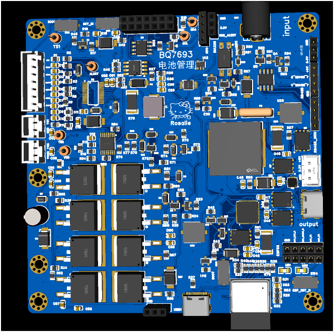

# 六串锂电池管理系统

基于 STM32F407ZG、BQ76930 和 BQ76200 的六串 BMS 设计，包含电芯采样、充放电控制、预充、被动均衡和故障记录。INA226 用于 USB 侧监测。

- `Hardware/BMS/`：BMS 应用、保护状态机、采样驱动、通信及故障存储。
- `USER/main.c`：STM32 应用入口。
- `tests/`：主机端模拟测试。安装 Python 3 和 Zig，设置 `ZIG_EXE` 指向 Zig 可执行文件，从仓库根目录运行 `python tools/test_firmware.py`。
- `docs/pcb-render.png`：嘉立创EDA 的 PCB 渲染图。

`BMS-Mainboard.epro` 包含可编辑原理图和 PCB，可导入嘉立创EDA。当前固件发布范围为可独立验证的 BMS 源码，540 项主机检查通过。STM32 完整固件构建还依赖原工程的 STM32 SPL/CMSIS、启动文件与 LCD 后端。仓库保留默认关闭的硬件输出许可。主机测试中的模拟许可设置仅用于测试程序。

## 许可

自有固件与测试使用 GPL-3.0-only。LibreSolar 衍生 OCV 数据保留 Apache-2.0 与来源说明，详见 Hardware/BMS/THIRD_PARTY_NOTICES.md。自有硬件设计使用 CERN-OHL-S-2.0。工程中随附的第三方器件库资料保留原许可。完整许可证文本在 LICENSES/。

